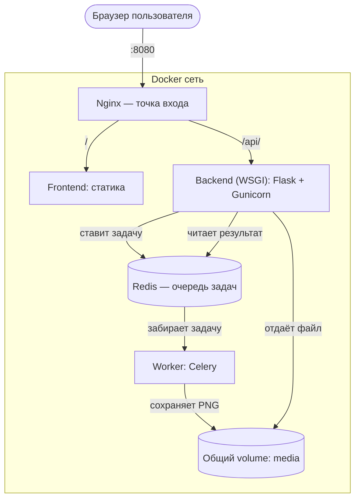

# Генератор аватарок по имени

## Описание

Веб-приложение, которое генерирует круглый аватар по введённому имени: градиентный фон и лёгкий геометрический узор (пятна разного размера и прозрачности) детерминированно строятся по MD5-хешу имени, поверх — инициалы. Одно и то же имя всегда даёт один и тот же аватар, а разные имена — визуально разные, а не выбор из фиксированного набора цветов.

Приложение построено как набор независимых сервисов, взаимодействующих через Docker-сеть, с единой внешней точкой входа через Nginx.

## Архитектура



Компоненты:

- **frontend** — статическая HTML/CSS/JS-страница (форма ввода имени, опрос статуса задачи, показ готового аватара). Раздаётся собственным nginx-контейнером.
- **backend** (WSGI, Flask + Gunicorn) — принимает запрос на генерацию, ставит задачу в очередь Celery/Redis и отдаёт результат по `task_id`. Сам аватары не рисует.
- **worker** (Celery) — забирает задачи из Redis и выполняет длительную операцию генерации изображения (`Pillow`), имитируя реальную нагрузку задержкой в 2 секунды. Работает в отдельном сервисе, не блокируя backend.
- **redis** — брокер сообщений и хранилище результатов Celery.
- **nginx** — единственная точка входа приложения, проксирует `/` на frontend и `/api/` на backend.

## API

| Метод | Путь                     | Описание                                              |
|-------|--------------------------|--------------------------------------------------------|
| POST  | `/api/avatars`            | Тело `{"name": "Имя Фамилия"}`, возвращает `{"task_id": "..."}` (202) |
| GET   | `/api/avatars/<task_id>`  | Статус задачи: `pending` / `success` (+`avatar_url`) / `failure` |
| GET   | `/api/media/<filename>`   | Отдаёт сгенерированный PNG-файл                         |
| GET   | `/api/health`             | Проверка живости backend                                |

## Запуск

```bash
docker compose up --build
```

После запуска приложение доступно по адресу:

```
http://localhost:8080
```

Введите имя в форму — через пару секунд появится сгенерированный аватар.

## Технологии

- Backend: Python, Flask, Gunicorn (WSGI)
- Очередь длительных задач: Celery, Redis
- Генерация изображений: Pillow
- Frontend: HTML, CSS, vanilla JavaScript
- Точка входа: Nginx
- Оркестрация: Docker Compose
